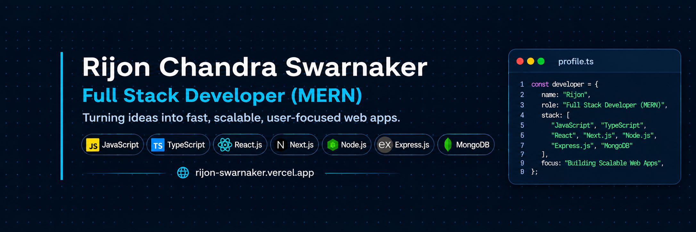

<!-- Banner -->

  

<!-- Animated Heading -->
<h1 align="center">
  
</h1>

## 👨‍💻 About Me

- 🚀 Full-Stack Developer focused on the **MERN Stack**.
- 🎓 Currently pursuing a Diploma in Computer Science & Technology.
- 💻 Building modern web applications using **React.js, Next.js, and TypeScript**.
- 🌱 Continuously improving my skills in **Node.js, Express.js, and MongoDB**.
- 🔐 Working with **JWT authentication and secure API development**.
- 💳 Implementing **Stripe payments and Webhook integrations**.
- 🎯 Focused on clean, reusable, and maintainable code.
- 🌐 Portfolio: [rijon-swarnaker.vercel.app](https://rijon-swarnaker.vercel.app/)
- 📫 Email: [rijonswarnaker@gmail.com](mailto:rijonswarnaker@gmail.com)

## 🛠️ Skills & Technologies

### Programming Languages

  

### Frontend Development

  

### Backend Development

  

### Database

  

### Payment Integration & Security

  
  

### Tools & Platforms

  

## 🤝 Connect With Me

  
  
  
  

## 📊 GitHub Statistics

  
  

  

---

  Thanks for visiting my profile!

